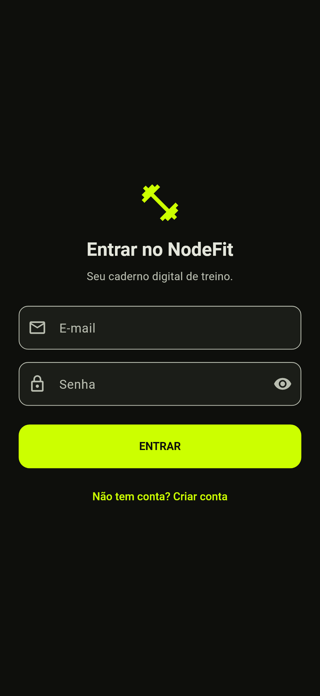
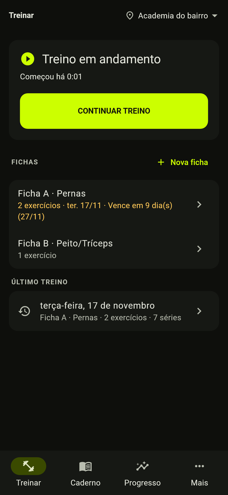
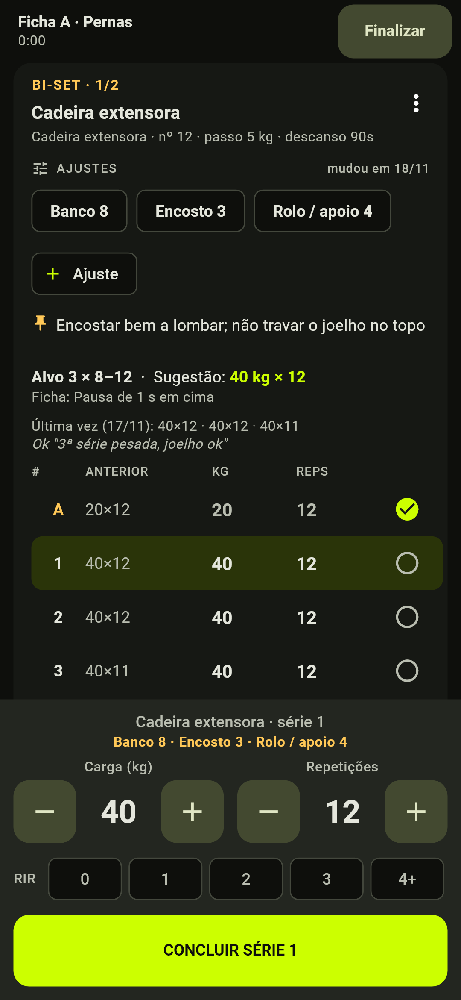
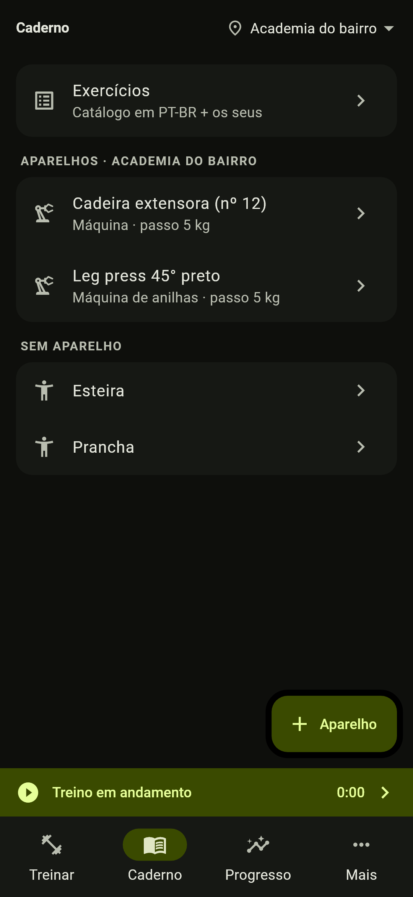
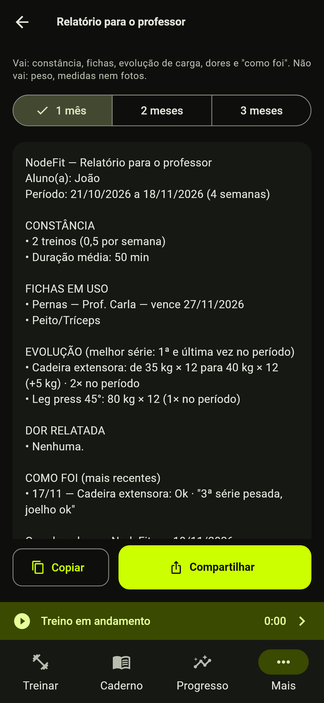
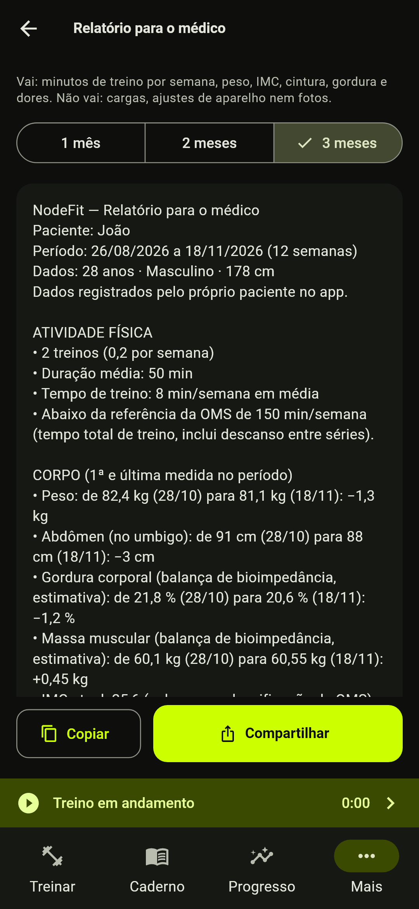

# NodeFit — caderno digital de treino

App de academia em Flutter (Android primeiro) que substitui o caderno de papel:
a carga e as repetições de cada série, **como foi** o exercício e **como você
deixa cada máquina ajustada** (Banco 7 · Encosto 3 · Pino 12). Funciona 100%
offline, com conta local.

> **Projeto P2 — Programação Mobile (Fatec Osasco, DSM).**
> Aluno: João Pedro Freire Vieira · GitHub: `Jhonny-Freire`

<p>
  
  
  
  
</p>

## Descrição do aplicativo

Quem treina em academia anota (ou esquece) a carga de cada exercício e como
regula cada máquina. O NodeFit resolve isso no celular: você monta suas
**fichas de treino**, cadastra as **academias e aparelhos** que usa, registra
cada série com poucos toques e acompanha a evolução (recordes, gráficos,
medidas do corpo). Tudo fica gravado num banco SQLite no próprio aparelho.

## Funcionalidades principais

- **Autenticação local:** cadastro, login, logout e telas protegidas (só quem
  está logado acessa o app). Erros tratados: campos vazios, e-mail inválido,
  senha curta, senhas diferentes, e-mail já cadastrado e login inválido.
- **CRUD completo** (após o login):

  | Entidade | Criar | Ler / listar | Atualizar | Excluir |
  |---|---|---|---|---|
  | **Check-ins do corpo** (peso, medidas) | Progresso → Corpo → Novo check-in | lista e gráficos | tocar no check-in e editar | **Apagar** (remove do banco) |
  | **Treinos** | Treinar → Iniciar treino | Progresso → histórico | séries, carga e reps durante o treino | **Apagar este treino** (histórico) e apagar série/exercício |
  | **Fichas de treino** (A/B/C) | Treinar → Nova ficha | lista na aba Treinar | nome, professor, vencimento, exercícios, séries, reps, descanso | **Arquivar** a ficha; **remover** exercício da ficha |
  | **Aparelhos** | Caderno → + Aparelho | lista por academia | nome, unidade, incremento | **Arquivar** (mantém o histórico de cargas) |

  Fichas e aparelhos são **arquivados** em vez de apagados porque os treinos
  antigos apontam para eles — apagar quebraria o histórico. Também é possível
  criar exercícios personalizados e renomear a academia.

- **Treino em andamento:** concluir série em 1 toque, timer de descanso com
  alarme (inclusive com a tela bloqueada), dupla progressão automática.
- **Progresso:** histórico, recordes, gráfico por aparelho, constância e
  evolução física (peso, medidas, fotos).
- **Relatórios para quem acompanha o aluno** (aba Mais → Compartilhar):
  - **para o professor:** constância, fichas em uso e vencimento, evolução
    de carga por exercício, dores relatadas e "como foi";
  - **para o médico:** minutos de treino por semana × referência da OMS,
    peso, IMC, cintura/abdômen, % de gordura (marcada como estimativa) e
    dores — sem cargas nem fotos.

  Período de 1, 2 ou 3 meses, prévia na tela, **Copiar** ou
  **Compartilhar** (WhatsApp, e-mail...).
- **Backup:** exportar/restaurar `.zip` e planilhas CSV.

## Quem usa o app (personas)

Detalhes, jornadas e decisões em [docs/PERSONAS.md](docs/PERSONAS.md).

| Persona | Papel | O que precisa |
|---|---|---|
| **Aluno** — Lucas, 24 | Único que mexe no app (tem a conta) | Registrar rápido e offline, ver o "anterior", subir carga na hora certa, guardar o ajuste de cada máquina |
| **Professor de educação física** — Carla, 31 | Recebe o relatório no salão ou no WhatsApp | Em 1 minuto: frequência, o que subiu, o que doeu e quando a ficha vence |
| **Médico** — Dr. Ricardo, 52 | Lê o relatório na consulta | Atividade por semana, peso, IMC, cintura, gordura e dores, com a origem de cada dado |

Professor e médico **não têm conta**: o app é offline e o aluno decide o que
compartilha. Por isso cada um recebe só o que precisa (dado de saúde é
sensível pela LGPD).

<p>
  
  
</p>

## Tecnologias utilizadas

| Camada | Tecnologia |
|---|---|
| Linguagem / framework | **Dart 3.13** (null safety) e **Flutter 3.47** — Android e **web** |
| Base de dados | **SQLite** via **Drift 2.35** (tipos gerados, streams reativas, migrações versionadas); na web, SQLite em WebAssembly + IndexedDB |
| Autenticação | Local, na mesma base: hash **PBKDF2-HMAC-SHA256** (pacote `crypto`) |
| Rotas / telas | **go_router 18** (abas com `StatefulShellRoute`, `redirect` protegendo as telas) |
| Estado | **Riverpod 3** (com geração de código) |
| Outros | flutter_local_notifications, fl_chart, camera, share_plus, file_picker |
| Testes | flutter_test — **120 testes** (regras, banco, migrações e telas) + capturas de tela |

## Instruções para executar o projeto

Pré-requisitos: Flutter 3.47+ (`flutter doctor` sem erros) e um celular
Android com depuração USB **ou** um emulador do Android Studio.

```bash
git clone https://github.com/Jhonny-Freire/NodeFit.git
cd NodeFit
flutter pub get
dart run build_runner build   # gera o código do Drift e do Riverpod
flutter run                   # abre no celular/emulador conectado
flutter test                  # roda os testes
```

Na primeira abertura aparece a tela de **login**: toque em **"Criar conta"**,
cadastre nome, e-mail e senha, e o app abre direto na aba **Treinar**.

### Versão web (navegador)

O mesmo código também roda no navegador — útil para apresentar sem celular:

```bash
flutter run -d chrome                 # desenvolvimento
flutter build web --release           # gera build/web
python -m http.server 8087 --directory build/web   # abre em http://localhost:8087
```

- O banco é o **mesmo SQLite**, compilado para WebAssembly (`web/sqlite3.wasm`
  + `web/drift_worker.js`, do pacote drift) e salvo no **IndexedDB** do
  navegador: conta, treinos e fichas continuam lá ao recarregar a página.
- Recursos que dependem do celular ficam **só no app Android** e somem na web:
  backup/restaurar `.zip`, planilhas, fotos do check-in, timer na tela
  bloqueada e leitura da balança Bluetooth.
- O `sqlite3.wasm` e o `drift_worker.js` precisam ser da **mesma versão do
  drift** do `pubspec.lock` (hoje 2.35.4); ao atualizar o drift, copie de novo
  de `<PUB_CACHE>/hosted/pub.dev/drift-<versão>/`.

> Dica (Windows): mantenha o projeto e o SDK em caminhos **sem acento e sem
> espaço** (ex.: `C:\Dev\NodeFit`). Com acento no caminho, o analisador e os
> testes do Flutter falham.

## Como funciona a autenticação

- As contas ficam na tabela **`users`** do banco: `id`, `name`, `email`
  (único, salvo em minúsculas), `password_hash` e `password_salt`.
- **A senha nunca é gravada.** No cadastro é gerado um **sal aleatório**
  (`Random.secure`) e a senha passa por **PBKDF2-HMAC-SHA256** com 10.000
  iterações; só o hash e o sal vão para o banco. No login o hash é
  recalculado e comparado em tempo constante.
- A **sessão** é o id do usuário logado, gravado na tabela `app_prefs`
  (chave `auth.session_user_id`). Fechar e abrir o app mantém o login; o
  **logout** (aba Mais → Sair) apaga só essa chave — os treinos continuam.
- **Proteção de telas:** o `GoRouter` tem um `redirect` (`authRedirect` em
  `lib/app/router.dart`) que observa o usuário logado. Sem sessão, qualquer
  rota vai para `/login` (guardando a tela pedida em `?from=`); com sessão,
  `/login` e `/cadastro` voltam para o app.
- E-mail inexistente e senha errada mostram a **mesma** mensagem ("E-mail ou
  senha incorretos.") para não revelar quais e-mails têm conta.
- Arquivos: `lib/core/domain/credentials.dart` (validações e hash),
  `lib/features/auth/data/auth_service.dart` (cadastro, login, logout,
  sessão) e `lib/features/auth/presentation/` (telas).

## Como funciona a base de dados

- **SQLite local** com **Drift**: as tabelas são classes Dart em
  `lib/core/db/tables.dart`, e o Drift gera as classes de dados e as
  consultas tipadas (`app_database.g.dart`). Nada depende de internet.
- **Schema v4**, 16 tabelas: `users`, `gyms`, `equipment`, `exercises`,
  `stations`, `station_settings`, `station_setting_changes`, `routines`,
  `routine_exercises`, `workout_sessions`, `session_exercises`,
  `workout_sets`, `body_checkins`, `body_values`, `body_photos`, `app_prefs`.
- **Migrações versionadas** (`onUpgrade` em `lib/core/db/app_database.dart`):
  a v4 só criou a tabela `users`, preservando os treinos de quem já usava o
  app (teste em `test/drift/nodefit/migration_test.dart`).
- O acesso ao banco passa sempre por um **repositório/serviço** (ex.:
  `RoutineRepository`, `GymRepository`, `AuthService`); as telas recebem
  **streams** e se atualizam sozinhas quando um dado muda.
- Cargas são inteiros × 1000 (62,5 kg = `62500`): sem erro de arredondamento.

## Organização do código

A estrutura sugerida na disciplina (`screens` / `services` / `models` /
`widgets`) aparece aqui organizada **por funcionalidade**:

| Sugestão da P2 | Onde está no NodeFit |
|---|---|
| `main.dart` | `lib/main.dart` (inicialização) e `lib/app/app.dart` |
| `screens/login_screen.dart`, `register_screen.dart` | `lib/features/auth/presentation/` |
| `screens/home_screen.dart` | `lib/features/workout/presentation/train_home_screen.dart` (abas em `lib/app/shell.dart`) |
| `services/auth_service.dart` | `lib/features/auth/data/auth_service.dart` |
| `services/database_service.dart` | `lib/core/db/app_database.dart` + repositórios em `lib/features/*/data/` |
| `models/` | `lib/core/db/tables.dart` (tabelas → modelos gerados) e `lib/core/domain/` (regras puras) |
| `widgets/` | `lib/core/widgets/` e `lib/features/*/presentation/widgets/` |
| rotas | `lib/app/router.dart` |

```
lib/
  main.dart
  app/          app, rotas (go_router + proteção), abas, tema
  core/
    db/         banco (Drift): tabelas e migrações
    domain/     regras em Dart puro (credenciais, progressão, recordes...)
    prefs/      preferências (inclui a sessão)
    widgets/    componentes reutilizáveis
  features/
    auth/       login, cadastro, logout (data + presentation)
    reports/    relatórios para o professor e o médico
    catalog/    exercícios
    gyms/       academias, aparelhos, estações e ajustes
    routines/   fichas de treino
    workout/    treino em andamento
    history/    histórico e resumos
    body/       evolução física
    backup/     exportar/restaurar
    settings/   aba Mais (conta, relatórios, backup, preferências)
assets/seed/    catálogo de exercícios (PT-BR, sem conteúdo de terceiros)
test/           domain · data (banco em memória) · widgets · drift (migrações)
```

Regras do código: widget nunca acessa o Drift direto (sempre um repositório);
regra de negócio em Dart puro vai para `core/domain`; o banco é a fonte da
verdade e as telas se atualizam por streams.

---

## Histórico de versões

- Plano completo, decisões e roadmap: [docs/PLANO.md](docs/PLANO.md)
- Pesquisa com fontes (out/2026): [docs/pesquisa/](docs/pesquisa/)

### v0.6 ("conta local" — P2 Fatec)

- Login, cadastro e logout com conta local; telas protegidas pelo roteador.
- **Personas** (aluno, professor, médico) em `docs/PERSONAS.md` e os
  **relatórios** para o professor e para o médico (prévia, copiar, compartilhar).
- **Banco v4** (tabela `users`), migração testada: quem já usava o app só
  precisa criar a conta na primeira abertura, sem perder nenhum treino.

### Fatia 1 ("alfa na academia")

- Catálogo com 90 exercícios em PT-BR; a busca ignora acento; dá para criar
  um exercício a partir da busca.
- Academias (inclusive "Casa") e aparelhos, cada um com unidade (kg, lb ou
  nº da placa), incremento e carga por lado ou total.
- **Estação = exercício × aparelho**: ajustes com histórico ("Banco 7 → 8"),
  nota fixada, coluna **Anterior** da mesma estação (outro aparelho só como
  referência).
- Treino livre: concluir série em 1 toque, steppers no passo do aparelho,
  RIR opcional, tipos de série, desfazer, trocar aparelho ocupado, "como foi"
  com tags. Timer de descanso dentro do app e tela ligada no treino.
- Tudo gravado a cada toque: o treino volta onde estava se o app fechar.
- Exportar backup (.zip com o banco e as fotos).

### Fatia 2 ("fichas e timer de verdade")

- Fichas A/B/C (próprias ou do professor, com vencimento): exercícios em
  ordem com séries × faixa de reps, descanso, aquecimentos, aparelho preferido,
  cadência e observação. A aba Treinar sugere a próxima do rodízio: 1 toque.
- Séries pré-preenchidas com a **dupla progressão**: todas no topo da faixa →
  sobe um incremento do aparelho e volta ao fundo da faixa.
- Timer na **tela bloqueada**: contagem regressiva na notificação e alarme
  exato no fim (som + vibração), mesmo com o app fechado.
- Ao finalizar: resumo com duração, volume e **recordes** (por aparelho).
- **Restaurar backup** (Mais → Backup, ou na primeira tela) e cópia
  automática diária do banco (as 3 últimas).

### Fatia 3 ("o que os concorrentes têm")

Lacunas encontradas comparando com Hevy, Strong, Fitbod e Smart Fit
(detalhes em `docs/PLANO.md`, seção 8):

- **Recorde na hora:** ao concluir uma série que bate a carga máxima ou o
  1RM estimado da estação, o app vibra forte e avisa ("🏆 Recorde de carga").
- **Aquecimento calculado:** os aquecimentos da ficha sobem em rampa até a
  carga de trabalho planejada (ex.: 40/60/80%), arredondados no passo do
  aparelho.
- **Anilhas sem conta:** em barra, Smith e máquina de anilhas, a zona do
  polegar mostra o que pôr de cada lado ("Cada lado: 20 + 1,25").
- **Gráfico de evolução** na tela da estação: carga máxima ou 1RM estimado,
  treino a treino.
- **Constância** na aba Progresso: dias na semana, semanas seguidas e um
  calendário das últimas 5 semanas.
- **Salvar como ficha:** um treino livre feito vira ficha com 1 toque.

### Fatia 4 ("bi-set e cardio")

- **Bi-set / tri-set:** no menu do exercício (treino) ou ao tocar nele
  (ficha), "Bi-set com o próximo". Depois de cada série o app pula para o
  par **sem descanso**; o descanso só começa quando a rodada fecha. Quem
  termina antes sai da rodada.
- **Cardio e exercícios por tempo:** esteira, bicicleta, elíptico, escada e
  remo anotam **tempo e distância**; prancha e pular corda, **só o tempo**.
  A zona do polegar troca carga/reps por tempo (e km); o "Anterior", o
  histórico e o resumo mostram "20:00 · 2,5 km". Ao criar um exercício, dá
  para escolher "Por tempo" ou "Cardio".
- **Banco v2** (migração testada com `test/drift/` e com uma cópia do banco
  real): só acrescenta colunas; backups antigos continuam restaurando.

### v0.2 ("evolução física")

- **Progresso → Corpo:** peso atual, gordura (da balança, ou estimada pela
  fita com a fórmula da Marinha, ±4 pontos), IMC, massa gorda/magra e a
  **tendência** do peso (média que ignora o sobe-e-desce de água e sal).
- **Check-in:** peso, fotos (frente, lado, costas), medidas com fita
  (pescoço, peito, cintura, abdômen, quadril, braço, coxa, panturrilha) e o
  que a **balança de bioimpedância** mostrou (gordura, músculo, água,
  visceral, osso, metabolismo...). Tudo opcional; mostra a última medida.
- **Fotos** com a anterior em transparência para repetir a pose, timer de
  3/10 s, guardadas fora da Galeria e dentro do backup.
- **Gráfico** de cada medida; fotos primeira × última lado a lado.
- **Séries por músculo** nos últimos 7 dias (Progresso → Treinos).
- **Lembrete semanal** de check-in e **exportar planilhas** (Excel/CSV) em
  Mais.
- **Banco v3** (tabelas de check-in, valores e fotos), migração testada.

### v0.2.1 ("ler a balança", beta)

- No check-in, **"Ler da balança (Bluetooth)"**: escuta os anúncios das
  balanças OKOK/Chipsea (formatos V20, V11, VF0 e C0), sem parear e junto
  com o app OKOK. Quando o peso trava, preenche o peso e guarda a
  impedância. Regras em `lib/core/domain/okok_scale.dart` (reimplementadas a
  partir da descrição do protocolo; sem código do openScale).
- Modelos que precisam de **conexão** (serviço 0xFFF0) são detectados e o
  botão "copiar diagnóstico" junta os anúncios crus para implementar depois.

## Rodando (detalhes para desenvolvimento)

- `flutter run` instala a build **debug** com o ID `dev.joaopedro.nodefit.dev`
  ("NodeFit DEV"), separada do app de uso real — testar nunca apaga treinos.
- App de uso real (release): `flutter build apk --release` e
  `adb install -r build\app\outputs\flutter-apk\app-release.apk`.
  **Não use `flutter install`**: ele desinstala antes e apaga os dados.

### Particularidades desta máquina (Windows com "ã" no usuário)

O toolchain foi movido para caminhos ASCII: SDK em `C:\Android\Sdk`,
`PUB_CACHE=C:\pub-cache`, `GRADLE_USER_HOME=C:\gradle`, e
`JAVA_TOOL_OPTIONS=-Djdk.net.unixdomain.tmpdir=C:\gradle\tmp` (sem isso o
Gradle falha com "Unable to establish loopback connection"). Abra um terminal
novo depois de mudar variáveis de ambiente.
